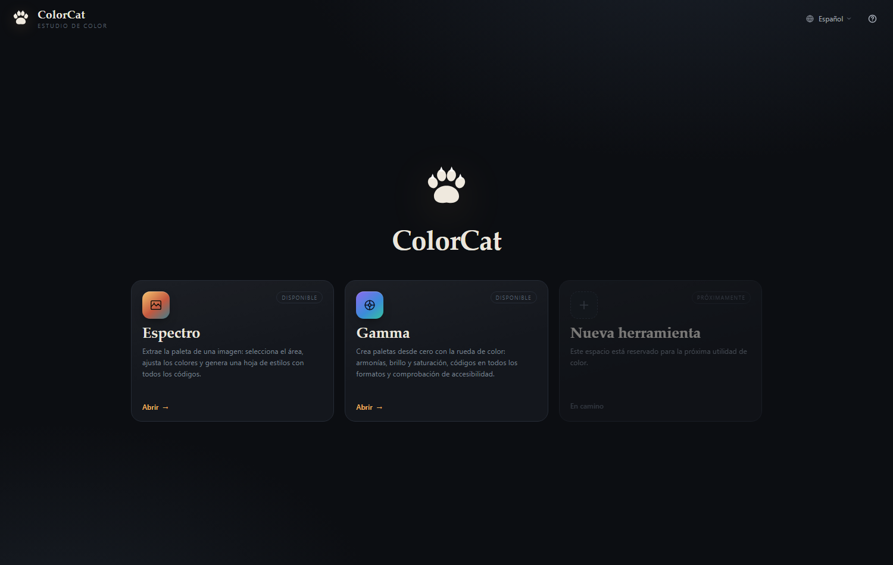
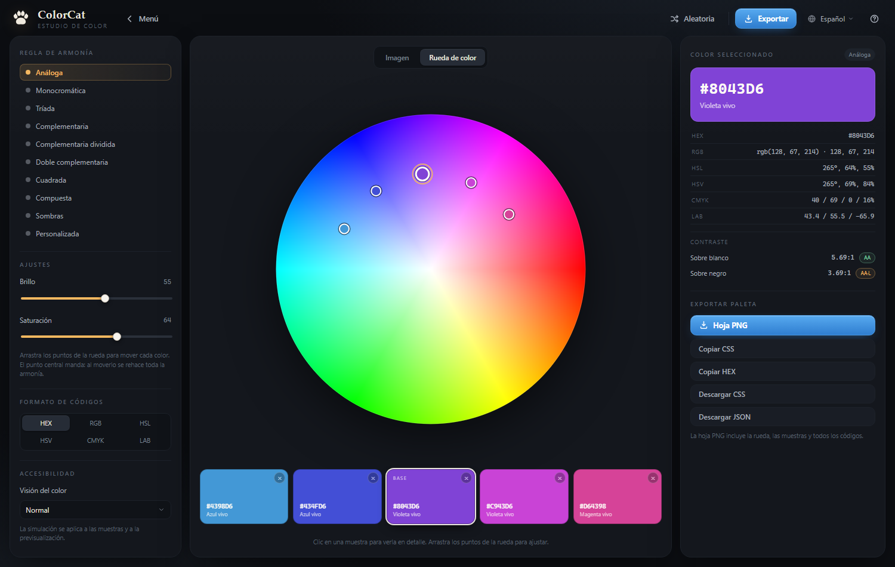
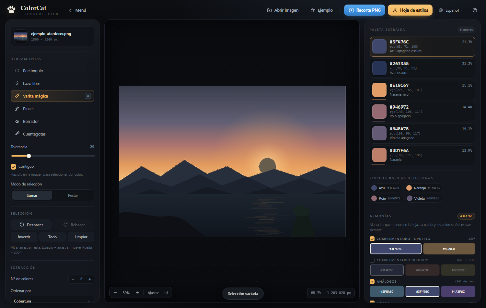
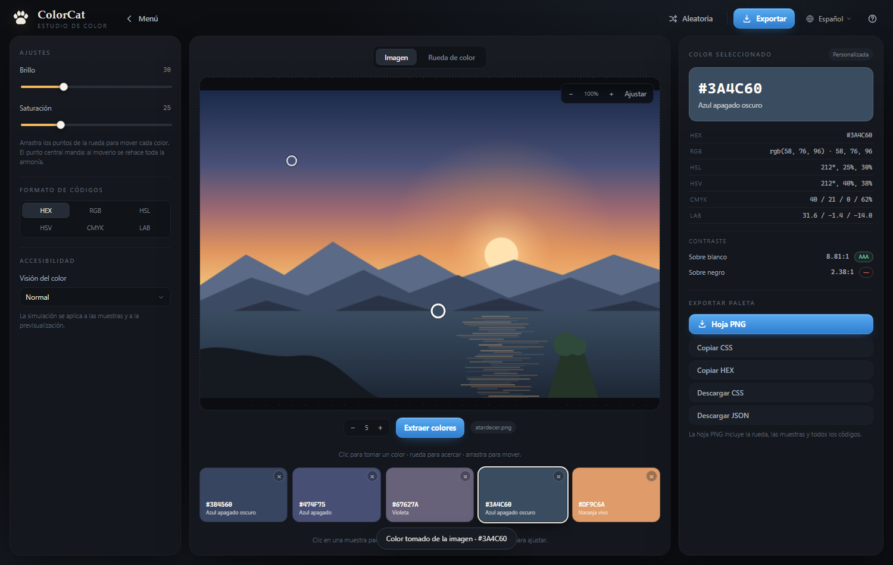
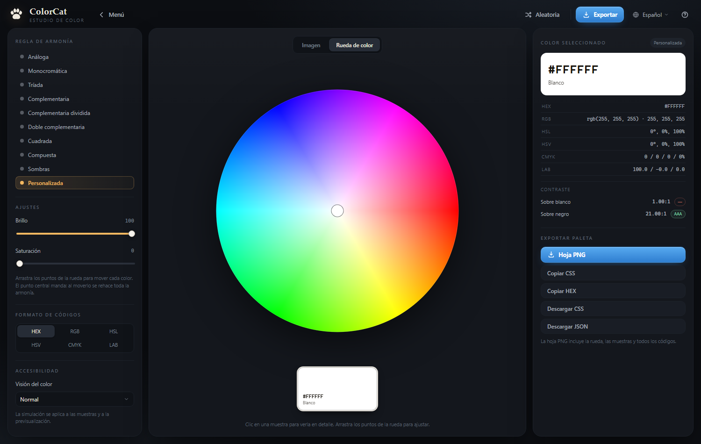

# ColorCat

**Estudio de color local.** Dos herramientas en una, con el mismo idioma visual:

- **Espectro** — extrae la paleta de una imagen: selecciona el área (con la varita
  mágica incluida), corrige, y genera una hoja de estilos con todos los códigos.
- **Gamma** — crea paletas desde cero sobre una rueda de color: armonías, brillo,
  saturación, códigos en seis formatos y comprobación de accesibilidad.

Todo ocurre en tu ordenador: **ninguna imagen sale de tu equipo**.

En la carpeta tienes dos muestras generadas con la propia app:
`ejemplo-hoja-de-estilos.png` (Espectro) y `ejemplo-gamma.png` (Gamma).





---

## Cómo se abre

**En internet (GitHub Pages).** La app es 100 % estática: no necesita servidor,
build ni dependencias. Publicada en GitHub queda accesible desde cualquier
navegador con una dirección como `https://tu-usuario.github.io/colorcat/`.

1. Crea un repositorio (por ejemplo `colorcat`) y sube todos los archivos de esta
   carpeta (incluido `.nojekyll`).
2. En el repositorio: **Settings → Pages → Build and deployment**.
3. En *Source* elige **Deploy from a branch**, rama **main** y carpeta **/ (root)**.
   Guarda.
4. Espera un minuto y abre `https://tu-usuario.github.io/colorcat/`.

Notas de despliegue:

- Todo usa **rutas relativas**, así que funciona igual en la raíz de un sitio
  (`tu-usuario.github.io`) que en un subdirectorio (`tu-usuario.github.io/colorcat/`).
- `.nojekyll` evita que GitHub procese los archivos con Jekyll.
- Al actualizar el contenido, sube los cambios y sube el número de versión de
  `styles.css?v=` y de los scripts en `index.html` para saltar la caché del navegador.
- No hace falta subir `app.py` ni `iniciar.bat`: son solo para uso local.

**En tu equipo**, para trabajar sin conexión:

1. **Doble clic en `iniciar.bat`** → arranca el servidor local y abre el navegador solo.
2. **Con Python** (desde esta carpeta):

   ```bat
   python app.py
   ```

   También admite `python app.py --port 9000` y `python app.py --no-browser`.

3. **Sin servidor:** doble clic en `index.html`. La aplicación es 100 % estática,
   así que funciona igual abierta como archivo.

> Requisitos: un navegador moderno (Edge, Chrome, Firefox, Brave…). Python solo es
> necesario para las opciones locales 1 y 2; no hay que instalar ninguna librería.

---

## Menú principal

Al abrir la app aparece el menú con una tarjeta por herramienta: nombre, descripción
y acceso. Desde dentro de cualquier herramienta, **Menú** (arriba a la izquierda) o
`Esc` vuelve aquí. La vista queda en la dirección (`#/espectro`, `#/gamma`), así que
se puede recargar o guardar el enlace directo.

---

## Espectro



### Flujo de trabajo

| Paso | Qué hacer |
|------|-----------|
| 1 | **Abrir imagen**: arrástrala a la ventana, pégala con `Ctrl+V` o usa *Abrir imagen*. |
| 2 | **Seleccionar el área** con rectángulo, lazo, varita mágica o pincel. |
| 3 | **Corregir** con el pincel (suma) y el borrador (resta). `Alt` mientras arrastras también resta. |
| 4 | La paleta se extrae sola al soltar; ajusta el **nº de colores** con `+` / `−`. |
| 5 | Elige un **color base** y marca qué **armonías** quieres en la hoja. |
| 6 | Pulsa **Hoja de estilos** para descargar el PNG, o **Recorte PNG** para guardar la selección. |

### Herramientas

- **Rectángulo** (`R`): arrastra para delimitar.
- **Lazo libre** (`L`): dibuja el contorno a mano alzada.
- **Varita mágica** (`W`): un clic selecciona la forma que tocas. Trabaja con un
  **camino mínimo sobre el mapa de bordes** (Dijkstra minimax): recorre la forma
  entera aunque tenga degradados, pliegues o textura, pero no cruza el contorno que
  la separa del resto. Ajustes:
  - **Tolerancia** (1–100): el borde más fuerte que está dispuesta a cruzar.
  - **Contiguo**: solo la mancha conectada, o todos los píxeles parecidos.
  - **Ajuste en vivo**: tras el clic, mueve la tolerancia y la selección se recalcula.
- **Pincel** (`B`) y **Borrador** (`E`): suman o restan zonas con presión de lápiz.
- **Cuentagotas** (`I`): añade muestras manuales que puedes copiar.

### Resultados

- Paleta con **HEX, RGB, HSL, oklch**, nombre descriptivo y cobertura.
- **Colores básicos detectados** por familias.
- **Armonías** sobre la rueda artística RYB (complementario/opuesto, dividido,
  análogos, tríada, tétrada, terciarios, monocromático), marcables una a una.
- **Contorno animado**: el área seleccionada se marca con una línea punteada blanca
  y negra que se mueve, como en Photoshop, para distinguirla de la imagen.
- **Hoja de estilos PNG** a doble resolución con barra de proporciones, miniaturas,
  tarjetas de color, básicos y las armonías marcadas.
- **Recorte PNG** de la selección con fondo transparente, a resolución original.

---

## Gamma



Un generador de paletas de cinco colores, al estilo de Adobe Color, con dos pestañas.

**Rueda de color**


- Al entrar hay **una sola muestra blanca**: elige el primer color haciendo clic (o
  arrastrando el punto) en la rueda.
- Un punto por color. Arrastra el punto central para rehacer la armonía; arrastra
  otro punto para mover ese color (la paleta pasa a **Personalizada**). Clic en
  cualquier zona libre de la rueda pinta la muestra seleccionada.
- **Reglas de armonía**: Análoga, Monocromática, Tríada, Complementaria, Complementaria
  dividida, Doble complementaria, Cuadrada, Compuesta y Sombras. Al cambiar de regla
  se recalcula una paleta de cinco colores desde el color base.
- **Brillo y saturación** con deslizadores, aplicados a la paleta completa.

**Imagen**
- Arrastra una foto (o usa *Elegir imagen*), elige con el contador **cuántos colores**
  quieres (2–12) y pulsa **Extraer colores**.
- Cada muestra tiene una **×** arriba a la derecha para quitarla; siempre queda al
  menos una.
- Haz **clic sobre la imagen** para tomar ese color: se lleva a la muestra
  seleccionada y queda **marcado con un círculo** de ese color sobre la foto.
- **Zoom** con la rueda del ratón o con los botones (−, +, *Ajustar*, hasta 10×);
  arrastra para moverte cuando está ampliada.
- En esta pestaña se oculta la regla de armonía (el panel queda con los ajustes, los
  formatos de código y la accesibilidad). Para armonizar la paleta extraída, pasa a
  **Rueda de color**: el color base de la imagen se conserva.
- La imagen se analiza en local, reducida a 1600 px para que sea rápido.

**Común a las dos pestañas**
- **Códigos en seis formatos**: HEX, RGB, HSL, HSV, CMYK y LAB. El formato elegido se
  ve en las muestras; el panel derecho muestra todos a la vez y cada fila se copia
  con un clic.
- **Accesibilidad**: contraste del color seleccionado sobre blanco y negro con
  insignias AA/AAA, y simulación de **protanopía, deuteranopía y tritanopía** sobre
  las muestras.
- **Aleatoria** para partir de una paleta nueva al azar.
- **Exportar**: hoja PNG con las muestras, CSS (copiar o descargar), HEX de toda la
  paleta y JSON con las conversiones.

---

## Idioma

El menú de la barra superior cambia toda la interfaz y también las hojas exportadas
entre **español** e **inglés**. El idioma predeterminado es el español; si eliges
inglés, la app lo recuerda y puedes volver cuando quieras.

---

## Sobre el modelo de color

- **Espectro** mide en sRGB y **OKLab** (perceptualmente uniforme) y calcula las
  armonías en la **rueda artística de 12 tonos (RYB)**, así que el complementario de
  un rojo es verde y el de un amarillo es violeta. Los análogos usan pasos de tono
  perceptualmente uniformes (±26°).
- **Gamma** trabaja en HSL/HSV sobre la rueda (como Adobe Color) y convierte a CMYK
  y CIE Lab para mostrar los códigos.

---

## Notas técnicas

- Sin dependencias, sin build y sin conexión: HTML + CSS + JavaScript. Se puede
  publicar tal cual en GitHub Pages, Netlify o cualquier hosting estático.
- La imagen se analiza a un máximo de **2600 px** de lado.
- La varita calcula un **mapa de bordes** (con los 8 vecinos) suavizado, busca el
  camino que minimiza el borde más fuerte a cruzar y limpia el resultado con un
  filtro 3×3 que quita píxeles sueltos y cierra huecos de un píxel.
- Las hojas exportadas se dibujan al doble de resolución para que los textos salgan
  nítidos al abrirlas o imprimirlas.
- La rueda de Gamma se dibuja una vez por tamaño (caché) y los puntos se repintan
  al arrastrar.

## Estructura

```
colorcat/
├─ .nojekyll                    Para GitHub Pages (sin procesado Jekyll)
├─ iniciar.bat                  Lanzador local para Windows (opcional)
├─ app.py                       Servidor local (opcional, solo biblioteca estándar)
├─ index.html                   Menú, Espectro y Gamma
├─ styles.css                   Estilo de la interfaz
├─ ejemplo-hoja-de-estilos.png  Muestra de Espectro
├─ ejemplo-gamma.png            Muestra de Gamma
├─ captura-inicio.png           Menú principal
├─ captura-gamma.png            Gamma
├─ js/
│  ├─ i18n.js                   Textos en español e inglés
│  ├─ color.js                  Matemática de color y rueda artística RYB
│  ├─ palette.js                Extracción (k-means++ en OKLab) y familias
│  ├─ export.js                 Render de la hoja de estilos en canvas
│  ├─ gamma.js                  Rueda, armonías, accesibilidad y exportación
│  └─ app.js                    Vistas, lienzo, selección y estado
└─ README.md
```

## Ideas para ampliar

- Exportar la paleta como `.ase` para Photoshop/Illustrator.
- Historial de paletas y edición numérica de cada color.
- Más reglas de armonía.

---

Hecho para pintar, ilustrar y diseñar con una referencia de color sólida.
